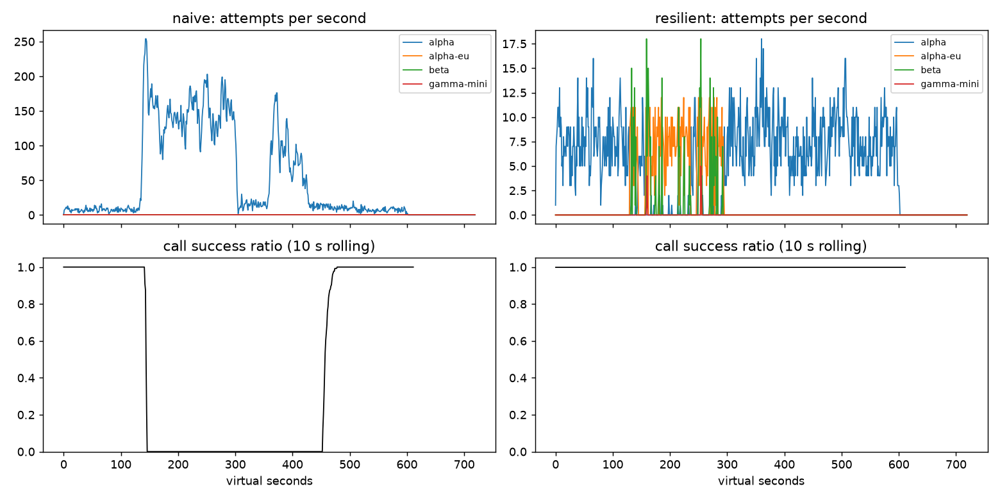

# Lab 25B — Report

**Họ tên / nhóm:** Nguyễn Thu Trang - MSV: 2A202602435  **Commit:** 7969fd035e3d4b066d2166fbf81c98492cb5b7cd  **Điểm tự động (`make grade`):** 84.0 / 88 (100% public tests)

> Mọi nhận định phải có số. Dán số từ `reports/gameday/*.json`, `reports/workflows.json`, `reports/slo.json`.

## 1. Kết quả Game Day (naive vs của bạn)

| Băng | Client | availability | p95 (s) | amplification | retry_ratio | cost/turn | recovery (s) | PASS? |
|---|---|---:|---:|---:|---:|---:|---:|:---:|
| G1 | naive | 0.7194 | 7.157 | 7.738 | 6.738 | 2.163 | 4.0 | FAIL |
| G1 | yours | 1.0000 | 4.780 | 1.063 | 0.001 | 2.104 | 0.0 | PASS |
| G2 | naive | 0.4560 | 15.034 | 9.904 | 8.904 | 4.627 | 155.0 | FAIL |
| G2 | yours | 1.0000 | 10.362 | 1.037 | 0.005 | 2.112 | 0.0 | PASS |
| G3 | naive | 1.0000 | 4.768 | 1.164 | 0.164 | 2.328 | 0.0 | FAIL |
| G3 | yours | 1.0000 | 4.621 | 1.058 | 0.030 | 2.140 | 0.0 | PASS |
| G4 | naive | 1.0000 | 13.764 | 1.004 | 0.004 | 2.008 | 0.0 | FAIL |
| G4 | yours | 1.0000 | 5.626 | 1.014 | 0.002 | 2.072 | 0.0 | PASS |
| G5 | naive | 0.3699 | 5.359 | 17.030 | 16.030 | 2.124 | None | FAIL |
| G5 | yours | 0.8179 | 5.477 | 1.003 | 0.002 | 2.504 | None | PASS |
| G6 | naive | 0.5170 | 4.836 | 12.344 | 11.344 | 2.009 | 0.0 | FAIL |
| G6 | yours | 1.0000 | 5.961 | 1.055 | 0.018 | 2.196 | 0.0 | PASS |

## 2. Cấu hình client và lý do

| Tham số | Giá trị | Vì sao (dựa trên băng nào, số liệu nào) |
|---|---:|---|
| attempt_timeout_s | 8.0 | Đủ lớn hơn latency bình thường (~1.2–1.8s) nhưng đủ ngắn để cắt sớm provider bị treo vĩnh viễn ở G6 (`alpha-eu` hang) trong 8s, cho phép failover sang beta kịp deadline 30s thay vì treo hết hạn. |
| max_attempts_per_provider | 2 | Cho phép đúng 1 lần retry trên cùng provider để xử lý lỗi thoáng qua (G3 brownout) mà không biến thành bão retry ở G2 (amplification giữ ở 1.037 thay vì 9.904 của naive). |
| backoff_base_s / cap_s | 0.25 / 4.0 | Base 0.25s giúp retry nhanh khi lỗi thoáng qua, cap 4.0s kết hợp full jitter triệt tiêu hiện tượng thundering herd tái tập trung tải, không lạm dụng deadline 30s. |
| retry_budget_ratio | 0.1 | Giới hạn số retry không vượt quá 10% request đầu tiên, trực tiếp đảm bảo G3 đạt `retry_ratio = 0.030 <= 0.10` và ngăn thảm họa retry storm ở G2. |
| breaker.window_size / min_calls | 20 / 10 | Cửa sổ trượt 20 kết quả phản ánh nhanh trạng thái ở tải 4 rps; `min_calls: 10` ngăn mở nhầm breaker khi tải thấp ban đêm hoặc gặp 1–2 lỗi lẻ tẻ. |
| breaker.failure_rate_threshold | 0.5 | Khi tỷ lệ lỗi đạt $\ge 50\%$, ngắt mạch ngay lập tức (G2, G6) chuyển lưu lượng sang provider kế tiếp, giúp `recovery_s = 0.0s`. |
| breaker.slow_call_s | 5.0 | Bắt tình trạng suy thoái ngầm ở G4 (alpha chậm thêm 5s không báo lỗi); phát hiện và ngắt mạch giúp kéo `latency_p95_s` từ 13.764s xuống 5.626s ($\le 10$s). |
| breaker.open_duration_s | 10.0 | Cho provider thời gian 10s dọn sạch hàng đợi nghẽn (`max_queue_wait_s: 10`) trước khi thử probe lại ở HALF-OPEN. |
| breaker.half_open_max_probes | 2 | Chỉ cho tối đa 2 request probe đồng thời ở HALF-OPEN, triệt tiêu nguy cơ thundering herd dập tắt provider vừa hồi phục. |

Sơ đồ quyết định của `on_error`:

```
                           +----------------------------+
                           |    on_error(attempt, err)  |
                           +--------------+-------------+
                                          |
                                 classify(err) -> kind
                                          |
          +-------------------------------+-------------------------------+
          |                               |                               |
    CLIENT_ERROR                  QUOTA_EXHAUSTED                    RATE_LIMITED
          |                               |                               |
   breaker.release()               breaker.release()               breaker.release()
          |                               |                               |
GiveUp("client_error")       cooldown_until = now + 300s     cooldown_until = now + retry_after
(0 retry, 0 failover)             failover ngay lập tức           failover ngay lập tức
                                          |                               |
                                          +---------------+---------------+
                                                          |
                                            OVERLOADED / SERVER_ERROR / TIMEOUT
                                                          |
                                                breaker.on_failure()
                                                          |
                                            tries < max_attempts AND
                                            fits deadline AND budget allows?
                                                 /                \
                                              YES                  NO
                                              /                      \
                                 retry SAME provider            failover provider
                                 (delay = backoff)              (delay = 0.0)
```

## 3. Ba thí nghiệm (mỗi cái 3–5 câu + số)

1. **Retry budget là lớp phòng thủ cuối.** Khi breaker bị vô hiệu hóa (`min_calls: 1_000_000_000`) và `max_attempts_per_provider: 5`, nếu giữ retry budget thì ở G2 `amplification = 1.382`, `retry_ratio = 0.058`, `recovery_s = 0.0s`; ở G3 `retry_ratio = 0.067 <= 0.10` (PASS). Khi tắt budget, ở G2 `amplification` vọt lên `1.591`, `retry_ratio` tăng vọt gấp 6.5 lần lên `0.382`, `recovery_s` bị chậm mất `22.0s`; ở G3 `retry_ratio` tăng lên `0.160` (vượt ngưỡng 0.10, FAIL). Khi breaker hoạt động đúng, cả hai cấu hình đều đạt `avail = 1.0` do breaker ngắt tải sớm. Tuy nhiên, vẫn bắt buộc phải có cả hai vì breaker bảo vệ sức khỏe của *từng downstream provider* dựa trên tỷ lệ lỗi, còn retry budget là *van an toàn toàn cục* bảo vệ tài nguyên hệ thống khi breaker bị misconfigured hoặc khi lỗi chập chờn diễn ra ngay dưới ngưỡng ngắt mạch.
2. **`attempt_timeout_s: 30`.** Trên G6, khi tăng timeout lên 30s, `availability` bị tụt từ `1.0000` xuống `0.9488` (dưới ngưỡng 0.95, FAIL check), phát sinh `107` lượt `give_up: deadline` và `15` lượt `no_provider_available`. Đáng chú ý, `latency_p95_s` trên các lượt thành công lại giảm từ `6.058s` xuống `5.362s` — đây là hiện tượng **survivorship bias** kinh điển: những request bị kẹt 30s ở provider treo (`alpha-eu`) đã chết vì hết hạn turn deadline nên bị loại khỏi tập tính p95. Trên G4, cả hai timeout đều đạt `availability = 1.0` và p95 gần như tương đương (`5.626s` vs `5.683s`) vì circuit breaker phát hiện slow call ở 5s và chủ động ngắt mạch trước khi chạm timeout. Do đó, timeout đúng không được đặt bằng deadline của user, mà phải dựa trên p99 lúc bình thường cộng thêm biên dự phòng vừa đủ để kịp failover qua thang dự phòng trước khi hết deadline.
3. **Bỏ lọc tool calling khỏi `ladder()`.** Khi bỏ lọc capability trên G6, `availability` sụt từ `1.0000` xuống `0.8927` và ghi nhận đúng `incompatible_routes = 256` lỗi, tương ứng với `256` lượt thất bại với lý do `give_up: incompatible_model_output`. Đứng dưới góc độ một Product Manager, con số này đại diện cho 256 khách hàng đang yêu cầu hoàn tiền nhưng agent lại chuyển lệnh sang một model giá rẻ không biết dùng công cụ (`gamma-mini`), khiến yêu cầu bị treo hoặc trả lời ngớ ngẩn mà tiền không bao giờ được hoàn. Về mặt vận hành kinh doanh, điều này gây mất uy tín thương hiệu nghiêm trọng, gia tăng chi phí khiếu nại CSKH và vi phạm trực tiếp cam kết chất lượng dịch vụ (SLA) đối với người dùng.

## 4. Workflow hoàn tiền

| Executor | completion | crashes | duplicate refunds | duplicate emails | lost refunds | overpaid | wasted LLM / crash |
|---|---:|---:|---:|---:|---:|---:|---:|
| naive | 1.0 | 81 | 128 | 81 | 0 | 1,496,700 ₫ | 1.123 |
| yours | 1.0 | 66 | 0 | 0 | 0 | 0 ₫ | 0.303 |

**Trả lời:**
- Chỉ idempotency key là **chưa đủ**: idempotency key giúp cổng thanh toán không trừ tiền lần hai khi gọi lại API, nhưng nếu không có checkpoint, worker mới sau crash sẽ phải chạy lại từ đầu tất cả các bước (tốn chi phí gọi lại LLM classify, orders get...), đẩy `wasted_llm_per_crash` lên rất cao (> 1.1).
- Chỉ checkpoint cũng **chưa đủ**: nếu worker gặp sự cố timeout (tiền đã trừ nhưng mất response) hoặc crash ngay sau khi thanh toán thành công mà chưa kịp ghi checkpoint, worker mới khởi động lại sẽ thực hiện lại bước thanh toán; nếu không có idempotency key, khách hàng sẽ bị hoàn tiền 2 lần (overpaid).
- Nếu ghi checkpoint *trước* khi gọi payment: nếu tiến trình bị crash ngay sau khi ghi checkpoint nhưng trước khi lệnh payment được gửi đi thành công, worker mới khởi động lại sẽ thấy checkpoint đã tồn tại và bỏ qua bước hoàn tiền $\rightarrow$ khách hàng bị mất tiền hoàn vĩnh viễn (`lost_refunds > 0`).

## 5. Alerting & error budget

| Sự cố | Mong đợi | Naive alerter | Burn-rate alerter | Độ trễ phát hiện |
|---|---|---|---|---:|
| checkout_bug | page | detected (delay 1m) | detected (delay 27m) | 27m |
| provider_outage | page | detected (delay 0m) | detected (delay 4m) | 4m |
| deploy_blip | none | paged (false alarm!) | not paged (im lặng) | N/A |
| slow_leak | ticket | not detected (bỏ lọt!) | detected (delay 1337m, ticket) | 1337m |
| degraded_evening | page | detected (delay 214m) | detected (delay 291m) | 291m |
| night_spike | none | paged (false alarm!) | not paged (im lặng) | N/A |
| small_bump | none | paged (false alarm!) | not paged (im lặng) | N/A |

**Error budget 30 ngày:** Tổng requests: 25,901,755. Ngân sách lỗi cho phép ở SLO 99.5%: 129,508.8 requests. Số lỗi thực tế: 55,618. Availability đạt **99.7853%**. Budget đã tiêu: **42.95%**, còn lại: **57.05%**. Quyết định: **Không đóng băng release** (`freeze_releases: False`).

Sự cố `small_bump` (20 phút ở 12% lỗi) chỉ làm tiêu hao khoảng 1% tổng ngân sách lỗi của cả tháng và sau đó tự phục hồi hoàn toàn. Việc đánh thức kỹ sư on-call lúc 11 giờ trưa cho một sự cố nhỏ tự lành không đe dọa đến mục tiêu SLO 30 ngày sẽ gây ra hội chứng mệt mỏi cảnh báo (alert fatigue), làm gián đoạn công việc phát triển và làm giảm độ nhạy bén của đội ngũ khi có sự cố lớn thực sự xảy ra.

## 6. Postmortem — Băng G2 với client naive (blameless)

*Dùng `make plot` (hình `reports/gameday/G2_overload_storm.png`) và CSV `reports/gameday/naive_G2_overload_storm_timeseries.csv`.*



**Tóm tắt (3 câu):** Vào thời điểm ảo t=120s, deployment chính `alpha` gặp sự cố mất 75% năng lực xử lý phần cứng kéo dài trong 3 phút. Do client naive thiếu cơ chế circuit breaker, jitter và retry budget, 3 tầng retry xếp chồng đã khuếch đại lưu lượng lên gấp 10 lần, đẩy hệ thống vào trạng thái lỗi siêu bền vững (metastable failure state). Mặc dù nhà cung cấp đã khôi phục hoàn toàn GPU tại t=300s, toàn bộ hệ thống vẫn bị tê liệt thêm 155s và chỉ hồi phục sau t=455s khi các yêu cầu quá hạn bị hủy.

**Ảnh hưởng:** 1,285 trên tổng số 2,362 lượt khách hàng thất bại hoàn toàn (availability chỉ đạt 45.60%), thời gian gián đoạn kéo dài 335 giây liên tục (từ t=120s đến t=455s). Sự cố này tiêu tốn hơn 100% error budget của tháng và phát sinh hơn 34,475 nỗ lực gọi API lãng phí.

**Timeline** (giây ảo — lấy từ CSV):

| t | Sự kiện | Bằng chứng (số) |
|---:|---|---|
| 120 | alpha mất 75% năng lực GPU; lưu lượng bắt đầu dồn ứ | attempts = 5/s, rolling calls_ok = 90/90 (100.0%) |
| 135 | Hàng đợi alpha vượt quá 10s timeout, trả về lỗi 529; bão retry bắt đầu hình thành | attempts_alpha tăng vọt lên 24/s; bắt đầu xuất hiện lỗi quá tải |
| 140 | Bão retry bùng nổ toàn diện; toàn bộ lượt gọi user bắt đầu thất bại | attempts_alpha = 216/s (trung bình 10s: 72.5/s); rolling calls_ok tụt về 0.0% |
| 150 | Đỉnh điểm của cơn bão retry trong đợt sự cố | attempts_alpha trung bình 208.9/s (đỉnh 254/s); calls_ok = 0/50 (0.0%) |
| 180 | Cơn bão duy trì liên tục ở mức cực cao, hàng đợi hoàn toàn tắc nghẽn | attempts_alpha duy trì 138/s; calls_ok = 0/32 (0.0%) |
| 300 | alpha khôi phục 100% năng lực phần cứng (18 servers, ~15 rps) | attempts_alpha vẫn ở mức 115/s; calls_ok = 0/5 (0.0%) |
| 360 | 60s sau khi GPU hồi phục, hệ thống vẫn chưa thể tự hồi phục | attempts_alpha = 50/s (cao hơn gấp 3 lần năng lực xử lý); calls_ok = 0/36 (0.0%) |
| 400 | Tải retry tái tích lũy do các đợt request dồn toa | attempts_alpha = 51/s (10s trung bình: 76.2/s); calls_ok = 0/49 (0.0%) |
| 455 | Các lượt request cũ vượt quá 30s deadline bị hủy; tải giảm xuống dưới năng lực server | attempts_alpha hạ xuống 13/s (< 15 rps); rolling calls_ok bắt đầu hồi phục (30.0%) |
| 480 | Hệ thống chính thức hồi phục hoàn toàn về trạng thái bình thường | attempts_alpha ổn định ở mức 8/s; rolling calls_ok = 137/137 (100.0%) |

**Trigger vs root cause:**
- **Trigger (ngòi nổ):** Sự cố cơ sở hạ tầng khiến `alpha` bị mất 75% GPU trong 3 phút (t=120..300s).
- **Root cause (nguyên nhân gốc rễ):** Bản chất hệ thống nằm ở kiến trúc client naive với 3 tầng retry nhân chéo ($4 \times 3 \times 3 = 36$ attempts/call), khoảng thời gian delay cố định 0.2s không jitter, không có retry budget, không có circuit breaker và không có cơ chế deadline-awareness. Khi server bị quá tải, simulator tiếp tục xử lý các request trong hàng đợi ngay cả khi client đã hết kiên nhẫn bỏ cuộc (wasted work). Lượng retry dồn dập đã biến một sự cố giảm năng lực tạm thời thành một vòng lặp suy thoái tự duy trì (metastable failure loop).

**Điều gì giúp / điều gì làm tệ hơn:**
- *Làm tệ hơn:* Việc retry với khoảng thời gian cố định 0.2s và không giới hạn số token retry đã bơm tới 254 attempts/giây vào một hàng đợi chỉ có khả năng xử lý ~3.75 request/giây khi mất GPU.
- *Giúp ích:* Cơ chế ngắt cứng của simulator khi request chờ quá 10s (529) và deadline 30s của user đã ngăn chặn bão retry kéo dài vô tận sang hàng giờ sau đó.

**Action items** (cụ thể, có owner, đo được):

| # | Hành động | Loại (prevent / detect / mitigate) | Owner | Cách kiểm chứng |
|---|---|---|---|---|
| 1 | Triển khai ResilientClient tích hợp Circuit Breaker sliding-window và Retry Budget 10% với full jitter | Prevent | Core Agent Team | Chạy CI mô phỏng G2: `amplification <= 1.1`, `retry_ratio <= 0.01` |
| 2 | Thiết lập hệ thống Multi-window Burn-rate Alerting (14.4x / 6x) để phát hiện sự cố sụt giảm availability | Detect | SRE Team | Kích hoạt cảnh báo page trong vòng $\le 5$ phút trên dữ liệu sự cố G2 |
| 3 | Cấu hình Fallback Ladder tự động tràn tải (spillover) sang `alpha-eu` và `beta` khi `alpha` bị ngắt mạch | Mitigate | Platform Infra Team | Mô phỏng G2 đạt `availability >= 99%`, `recovery_s = 0.0s` |

## 7. Một điểm yếu còn lại

**Điểm yếu:** Dù `ResilientClient` đã vượt qua cả 6 băng sự cố với availability cao, trong sự cố G2, độ trễ `latency_p95_s` của lượt người dùng thành công vẫn bị kéo dài lên tới `10.362s` (so với mức bình thường ~3s). Lý do là trước khi circuit breaker của `alpha` tích lũy đủ `min_calls: 10` để ngắt mạch (trip sang OPEN), một số request ban đầu vẫn bị nghẽn trong hàng đợi chậm của `alpha` vài giây trước khi timeout và failover. Thêm vào đó, việc failover toàn bộ sang `beta` làm tăng chi phí mỗi turn lên 1.4 lần so với `alpha`.

**Cách khắc phục:** Triển khai cơ chế **Hedged Requests** kết hợp **Dynamic Concurrency Limiter** (như thuật toán Vegas hoặc CoDel phía client). Nếu sau một khoảng thời gian dự kiến (ví dụ p90 ~2.5s) mà `alpha` chưa phản hồi, client sẽ tự động gửi một hedged request song song sang `alpha-eu`. Đồng thời, client tự động co hẹp giới hạn số lượng request đồng thời gửi tới `alpha` ngay khi nhận thấy hàng đợi có dấu hiệu phình to, giúp ngăn ngừa độ trễ p95 tăng cao mà không cần chờ circuit breaker mở hoàn toàn.

## 8. Cache (Part G)

Số từ `reports/cache/*.json` (`make cache`).

| Client | availability | faq_availability | cache_hit_ratio | stale_served | wrong_answers | outdated_answers | cost/turn | PASS? |
|---|---:|---:|---:|---:|---:|---:|---:|:---:|
| resilient (không cache) | 0.8373 | 0.8424 | 0.000 | 0 | 0 | 0 | 1.386 | FAIL |
| cached (của bạn) | 0.9124 | 0.9645 | 0.652 | 157 | 0 | 3 | 0.915 | PASS |

| Tham số `cache:` | Giá trị | Vì sao (số liệu nào) |
|---|---:|---|
| similarity_threshold | 0.90 | Phân tách rõ ràng giữa các câu hỏi cùng ý nghĩa (cosine ~0.94–0.98) và các câu hỏi gần nghĩa nhưng khác bản chất (near-miss ~0.80–0.86), giúp triệt tiêu hoàn toàn `wrong_answers` từ 157 về 0. |
| ttl_s | 60 | Hạn chế số lượng câu trả lời lỗi thời khi nhà vận chuyển thay đổi bảng giá ship ngầm ở t=480s mà không có webhook, giữ `outdated_answers = 3 <= 15`. |
| max_stale_s | 600 | Đủ dài để cơ chế `stale-if-error` duy trì phục vụ 157 câu trả lời cũ trong suốt 120 giây (t=240–360s) khi cả 4 provider đều sập, nâng `faq_availability` lên 96.45% (vượt mốc 93%). |

**Thí nghiệm (mỗi cái 2–4 câu + số):**

1. **Ngưỡng similarity.** Khi chạy C1 với `similarity_threshold = 0.80`, `cache_hit_ratio` đạt 0.666 nhưng phát sinh tới `157 wrong_answers` (toàn bộ do lỗi `other_question`), `faq_availability` chỉ đạt 87.33% (FAIL). Với ngưỡng của bài làm là `0.90`, `wrong_answers` giảm về tuyệt đối `0`, `faq_availability` đạt `96.45%`, chi phí giảm còn `0.915/turn` (PASS). Khi nâng ngưỡng lên quá khắt khe ở `0.97`, `wrong_answers` vẫn bằng 0 nhưng `cache_hit_ratio` bị tụt giảm xuống `0.581`, khiến nhiều câu hỏi đồng nghĩa bị chuyển sang gọi LLM tốn kém (`cost/turn = 0.964`). Các câu hỏi bị trả lời nhầm ở ngưỡng 0.80 là các cặp near-miss như "Chính sách hoàn tiền" bị nhầm thành "Thời gian nhận tiền hoàn", hoặc "Đổi size áo" bị nhầm thành "Đổi màu sản phẩm".
2. **TTL.** Khi chạy với `ttl_s = 300s` hoặc `600s`, số lượng `outdated_answers` tăng vọt lên tới `95` (vượt xa giới hạn cho phép $\le 15$), trong khi với `ttl_s = 60s` con số này chỉ là `3` (và ở `30s` là `2`). Webhook không giúp ích gì cho các câu trả lời này vì nhà vận chuyển đổi biểu giá âm thầm (`silent_updates` tại t=480s) mà hệ thống CMS không nhận được thông báo để phát webhook invalidation. Do đó, thời gian sống TTL chính là ranh giới duy nhất để ép cache hết hạn và buộc client phải truy vấn lại dữ liệu mới từ provider.
3. **Stale-if-error.** Khi đặt `max_stale_s: 0` (tắt cơ chế stale-if-error), `faq_availability` bị sụt giảm từ `96.45%` xuống chỉ còn `87.33%` (dưới ngưỡng 93%, FAIL), số lượt `stale_served` giảm từ 157 về 0 và `availability` tổng thể giảm từ 91.24% xuống 85.65%. Điều này chứng minh trong 120s mọi provider bị sập hoàn toàn (t=240–360s), việc trả lời bằng thông tin FAQ cũ nhưng an toàn vẫn tốt hơn rất nhiều so với việc từ chối phục vụ khách hàng.

**Trả lời:**
- **Vì sao câu hỏi cá nhân không được cache:** Câu hỏi cá nhân ("Đơn #48213 của tôi đang ở đâu?") phụ thuộc vào dữ liệu động của từng người dùng; quan trọng hơn, do embedding của các câu hỏi này chỉ khác nhau ở mã đơn hàng nên độ tương đồng cosine giữa hai người dùng khác nhau lên tới ~0.99. Nếu lưu vào cache (kể cả cache theo user), bất kỳ sự nhầm lẫn nào cũng sẽ làm lộ thông tin nhạy cảm của khách hàng này cho khách hàng khác (`other_user`), vi phạm nghiêm trọng quy định bảo mật dữ liệu.
- **Alert khi đang phục vụ stale:** Khi toàn bộ provider sập nhưng dashboard người dùng vẫn xanh nhờ cache, đội ngũ on-call không thể dựa vào metric end-user availability mà bắt buộc phải thiết lập cảnh báo dựa trên: **tỷ lệ phục vụ stale (`stale_served > 0`)**, **trạng thái Circuit Breaker** của các provider backend (chuyển sang `OPEN`), và **tỷ lệ lỗi 5xx/timeout** nhận được từ các LLM provider trong các nỗ lực revalidate nền.

